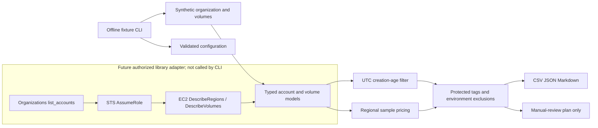

# AWS EBS Cost Optimizer

Offline-first, read-only Python tooling to identify currently unattached EBS volumes whose **volume creation age** meets a configurable threshold, estimate an illustrative monthly storage run rate, and write a non-executable manual-review plan. The default CLI consumes synthetic JSON fixtures; it does not create AWS clients or make network calls.

> **Code-only lab:** no AWS account was accessed, no live resource was scanned or modified, and no volume was deleted. Fixture prices and IDs are synthetic. This tool does not implement a deletion command.

## Original problem statement

The original Code Clinic package requirements are included: clear problem, architecture, prerequisites, usage and examples; organized code and tests; configuration examples and sample inputs; security and idempotency guidance; and CI checks for linting and validation.

Enterprises with many AWS accounts and regions can accumulate EBS volumes after workloads are decommissioned. This project addresses the Code Clinic assignment to build reusable Boto3-based automation that enumerates active AWS Organizations accounts, assumes approved read-only member roles, discovers unattached volumes across regions, filters by age, estimates costs, and produces reports plus an optional review plan. Code is exercised only with mocked API clients and synthetic examples in this lab.

## Business use case

Central platform and FinOps teams need a repeatable inventory to prioritize storage waste across development, staging, and production. Reports help teams locate volumes and route them to owners for verification. An `available` state only describes the current attachment state. It does not prove the volume is unused, unneeded for recovery, or safe to delete.

## Architecture



## Features

- Organizations account pagination and active-account filtering in a dependency-injected adapter.
- Short-lived STS role assumption using a configurable role name.
- Explicit or automatically discovered enabled regions and paginated `DescribeVolumes`.
- Region and account scoped error records for partial scans.
- Volume metadata includes account/name, region/AZ, type, size, `CreateTime`, age, attachment state, tags, encryption/KMS, IOPS and throughput.
- Decimal monthly run-rate estimates with regional fixture data, explicit gp3 included performance, provisioned IOPS and throughput charges, and explicit missing-price status.
- Stable CSV, JSON and Markdown reports with account/region/type summaries.
- Optional JSON cleanup review plan with policy exclusions, risk labels, and mandatory manual approval.
- The CLI exposes fixture mode only; the library AWS adapter is not invoked by CLI or CI.

## Repository structure

```text
src/ebs_optimizer/       Configuration, models, AWS adapters, policies, pricing, CLI, reports
config/                  Example config and synthetic regional pricing
examples/                Synthetic organization/volume fixtures and rendered example reports
policies/                Example least-privilege IAM and trust policy documents
tests/                   Mock-based offline unit and CLI tests
docs/                    Architecture, security, FinOps methodology, limitations
reports/                 Local generated outputs; ignored by Git
```

## Prerequisites and installation

Python 3.11+ and pip. From this project directory:

```bash
python -m venv .venv
# Linux/macOS
source .venv/bin/activate
# Windows PowerShell: .venv\Scripts\Activate.ps1
python -m pip install --upgrade pip
python -m pip install -e ".[dev]"
```

No AWS CLI, AWS credentials, network access to AWS, or cloud resources are needed for the examples and tests.

## Configuration

Copy and edit `config/config.example.yaml`. `discovery.minimum_age_days` must be a non-negative integer. `aws.regions` can list approved regions; an empty list means the future library adapter will query enabled regions. `aws.included_accounts` and `aws.excluded_accounts` filter the future Organizations adapter. Report formats are selected from `csv`, `json`, and `markdown`. `deletion_plan.protected_tags` maps tag names to values that exclude matching volumes.

The sample pricing file documents its source and effective date. Its values are deliberately illustrative, vary by region, and do not represent AWS prices. Missing region or volume type data is reported as unavailable rather than $0. The future AWS adapter accepts account include/exclude IDs and explicit regions; an empty region list uses EC2 `DescribeRegions` from the configured region-discovery endpoint.

## Offline usage

From this directory, run:

```bash
python -m ebs_optimizer.cli --help
python -m ebs_optimizer.cli --fixture examples/sample_organization.json --min-age-days 30
python -m ebs_optimizer.cli --fixture examples/sample_organization.json --min-age-days 60 --format csv,json,markdown
python -m ebs_optimizer.cli --fixture examples/sample_organization.json --min-age-days 90 --generate-deletion-plan
```

Useful overrides include `--config`, `--pricing`, `--output-dir`, and `--reference-time 2026-01-31T12:00:00Z`. CLI age and format options override config. The shipped fixture includes a fixed UTC reference time to make its reports repeatable. Files use fixed names and are overwritten atomically on each run. The CLI does not provide a live mode and does not silently fall back to AWS.

## Sample reports

The `examples/sample_report.*` files are generated from the synthetic organization fixture and clearly marked illustrative. The report includes scan coverage, unattached counts, age-qualified volume count, reviewable capacity, monthly and annualized run-rate estimates, grouping by account/region/type, individual volume details, and partial-scan errors. The optional plan is named `ebs-deletion-review-plan.json` and is only an informational review artifact.

## Cost calculation methodology

AWS documents gp3 baseline performance and separate charges for provisioned performance in its [EBS volume type guide](https://docs.aws.amazon.com/ebs/latest/userguide/general-purpose.html) and [EBS pricing page](https://aws.amazon.com/ebs/pricing/). These product rules inform the calculation model; fixture rates are synthetic and are not represented as current regional AWS prices.

Monthly storage cost is provisioned GiB multiplied by the configured regional rate. The fixture also models gp3 performance above its included 3,000 IOPS and 125 MiB/s, io1 provisioned IOPS, and progressive io2 fixture IOPS tiers. Decimal arithmetic is rounded to cents. The cost is a normalized full-month run rate; annualized values multiply that estimate by 12.

AWS bills actual usage over time, and real prices vary by region, commercial terms, discounts, credits, and billing adjustments. This estimate excludes snapshots and related services and is not an invoice or realized savings. See [FinOps methodology](docs/finops-methodology.md).

## Security and IAM

The example policies in `policies/` show a management identity with only `organizations:ListAccounts` and `sts:AssumeRole` to the named role. The member role permits only `ec2:DescribeRegions` and `ec2:DescribeVolumes`; there are no write or delete permissions. Trust policy identifiers are explicit placeholders. Review them against your organization before any future use. Use the standard AWS credential provider chain; never place credentials in config or fixtures. STS secrets are passed in memory and never logged.

Report files may contain sensitive account IDs, tags, and inventory details. Generated files are ignored by Git and use owner-only POSIX permissions where supported. On Windows, use appropriate NTFS ACLs.

## Cleanup plan safety

The plan labels eligible records `manual_review_only` and always sets `manual_approval_required: true`. Production, protected tags, unavailable pricing, and insufficient metadata can exclude a volume. Risk labels prioritize human review; low priority does not mean safe to delete. Before a separately approved operational change, owners must verify snapshots, backups, retention, dependencies, and recovery requirements. No delete API, automated approval, snapshot action, or destructive CLI option exists.

## Repeatability and idempotency

Discovery adapters are read-only. Re-running a fixed fixture with the same reference timestamp and config yields deterministic sorted report data and overwrites the same output filenames atomically. Fixture inputs are not modified. Live AWS results can change between scans; current state alone cannot establish unattached duration.

## Testing and quality checks

```bash
ruff check src tests
ruff format --check src tests
bandit -q -r src
pytest -v
pytest --cov=ebs_optimizer --cov-report=term-missing --cov-fail-under=85
```

Tests use synthetic data and mocks; they never need AWS credentials. They cover Organizations pages and filters, STS failures, EC2 pagination/region failures, UTC age boundaries, pricing types and missing regions, reporting, deletion-plan exclusions, CLI validation, and offline execution. Coverage is measured by pytest-cov; no target is claimed until measured.

## CI/CD

The repository workflow at `.github/workflows/python-ci.yml` runs on pull requests and pushes to `main`. It installs the project and development extras, then runs Ruff lint/format, Bandit, pytest, coverage, and an offline CLI integration check. Workflow permissions are read-only. It configures no AWS credentials or OIDC and provisions or modifies no infrastructure.

## Troubleshooting

- **Fixture not found:** run commands from this directory or pass an absolute `--fixture` path.
- **Invalid age/format:** use a non-negative integer and only `csv`, `json`, or `markdown`.
- **Pricing unavailable:** add an explicitly sourced regional fixture rate; the tool intentionally does not guess.
- **Partial scan:** inspect each error scope in JSON/Markdown. Do not describe a partial scan as organization-wide coverage.
- **Report write failure:** check the output directory and local filesystem permissions. Existing fixed-name reports are replaced.
- **AWS access errors:** the CLI is offline-only. For a future external adapter caller, review Organizations permission, role trust, role permission, region opt-in, and throttling separately.

## Limitations

- No AWS accounts were accessed and no live resources were scanned or changed.
- No EBS volumes were deleted; no deletion functionality exists.
- Prices and sample resource identifiers are synthetic and illustrative.
- `CreateTime` measures volume age, not duration unattached.
- Estimates are run rate, not actual charges or verified savings.
- The AWS adapters are mockable library components and are not invoked in this lab CLI or CI.

## Future enhancements

Potential follow-on work includes official AWS Pricing API or Cost Explorer data, historical attachment tracking, AWS Config integration, centralized reporting, scheduled organization scanning, and enterprise approval workflows. These are not implemented.
