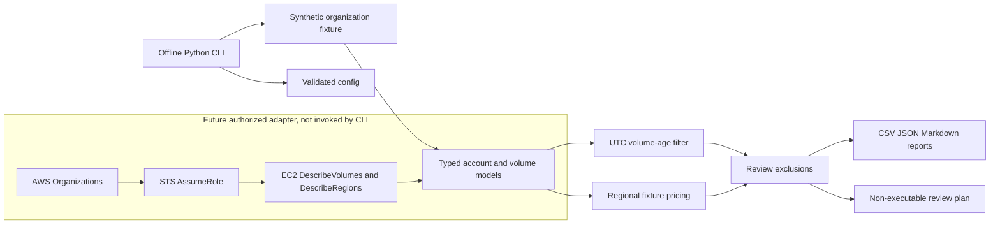

# Architecture

The package separates configuration and domain rules from AWS API adapters and report output. The default CLI is fixture-only and cannot create boto3 clients.

For future authorized callers, `runtime.scan_organization` composes the Organizations, STS, and EC2 adapters using injected sessions. Tests use fakes and mocked responses. No workflow invokes that adapter.

